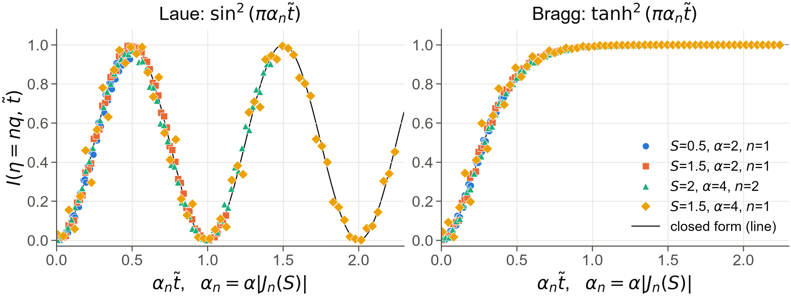
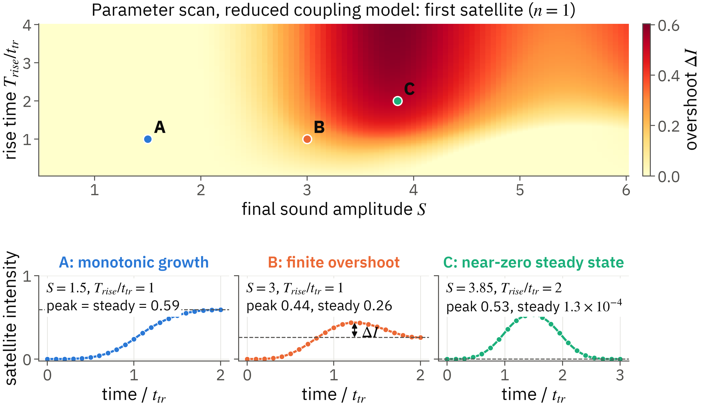

# TraTT: formation and memory of acoustic diffraction satellites in a crystal traversed by a sound wave

*Status: draft for physics reading. Software version: TraTT 0.1.0, from [pyproject.toml](../pyproject.toml). Every numerical value below is taken from a file in this repository, identified in the relevant section; nothing was rerun for this paper. Results are calculations, not experimental measurements. Later corrections recorded in the repository take precedence over earlier claims.*

## Abstract

A travelling acoustic wave produces satellites around a crystal's X-ray Bragg reflection. TraTT asks how these satellites appear while the acoustic front is still inside the crystal, and how a gradual change in the drive is recorded in diffraction. It solves the two-beam Takagi–Taupin equations for a frozen displacement profile at each observation time, in symmetric Laue and Bragg geometries. For resolved satellites, the centre intensity follows the response of a crystal of the acoustically filled depth, with coupling multiplied by the Bessel weight $J_n(S)$. The resulting satellite Pendellösung time is $\tau_n=\Lambda_P/(v_s|J_n(S)|)$, independent of total crystal thickness. A varying envelope replaces the instantaneous Bessel weight by a depth integral of its retarded history. This produces overshoot and permits a satellite to be bright during turn-on while nearly absent at the final amplitude. A saved scan of 11,211 conditions using the reduced $\Theta_1$ law in Laue geometry with $\alpha=0.5$, $n=1$ and a linear ramp gives a largest excess intensity of 0.603419 on the boundary of the scanned rise times, rather than an unconstrained optimum. An independent Floquet calculation tests the filled-crystal limit. A separate linear-response calculation connects strain spectra to reflectivity spectra, but its long-window interpretation cannot be applied to short measurements without a window correction. No experimental validation or experimental detection limit has been measured.

Sources: [lab notebook](../notes/lab_notebook.md), formation, memory, Floquet, transfer-function and overshoot studies; [research summary](research/README.md); later corrections in [lineage](lineage.md). The scan count and excess are from the notebook's overshoot study.

## 1 Background and question

In dynamical X-ray diffraction, forward and diffracted waves exchange amplitude as they propagate through a sufficiently perfect crystal. Here $\Lambda_P$ denotes the intensity Pendellösung period: an unstrained, lossless Laue slab on the refraction-corrected Bragg condition has intensity $\sin^2(\pi L/\Lambda_P)$. A periodic lattice displacement modulates the phase of the coupling and produces acoustic satellites. For acoustic wave vector $K$, satellite $n$ is centred at mismatch $\beta=nK$; its coupling contains $J_n(S)$, where $S=\mathbf h\cdot\mathbf u_0$ is the displacement modulation index.

The filled, periodically deformed crystal is an established problem. The question here concerns the preceding interval: sound enters at a surface and propagates at speed $v_s$, so only a depth $v_st$ is vibrating before the transit time $t_{\rm tr}=L/v_s$. Does the satellite grow according to that depth, which order forms first, and can its intensity be inferred from the drive amplitude at the current time? A further question is whether the Fourier spectrum of a time-dependent reflectivity trace directly represents the strain spectrum.

The calculation is stroboscopic. It does not integrate an explicit electromagnetic time derivative: it solves a succession of static propagation problems with different lattice profiles. The notebook's quasi-static estimate gives an X-ray crossing time of 0.99 ps against an acoustic period of 500 ps, or 0.2%, for its least favourable proposed case. This supports freezing the lattice for those conditions, rather than establishing the approximation for arbitrary geometry or frequency.

Sources: [background](background.md), [equations](equations.md), and [lab notebook](../notes/lab_notebook.md), quasi-static and prior-art studies. All numerical times and their ratio above come from the notebook's quasi-static estimate. The period convention also follows its material-mapping study.

## 2 Method

### 2.1 Variables, drive and propagation

Use dimensionless depth and time,

$$
\zeta=z/L,\qquad \tilde t=t/t_{\rm tr},\qquad
\alpha=L/\Lambda_P,\qquad \eta=\beta L,
$$

and write

$$
q=KL=2\pi L/\Lambda_{\rm ac},\qquad
w=\Omega t_{\rm tr}=q,\qquad
R=\frac{\Lambda_{\rm ac}}{\Lambda_P}=\frac{\alpha}{\alpha_{\rm ac}},
\quad \alpha_{\rm ac}=L/\Lambda_{\rm ac}.
$$

The equality $w=q$ assumes nondispersive propagation, $\Omega=Kv_s$. The drive is

$$
\varphi(\zeta;\tilde t)=S A(\tilde t-\zeta)
\sin(q\zeta-w\tilde t),\qquad A(s<0)=0.
$$

Thus depth samples the retarded drive history. A step envelope represents abrupt onset; the package's finite-rise envelope is a smoothstep. The overshoot scan discussed below instead uses a causal linear ramp held at its final value. These envelopes are distinct calculations.

For Laue geometry, both beams enter the depth evolution in the same direction:

$$
\frac{dD_0}{d\zeta}=i\pi\alpha e^{i\varphi}D_h,\qquad
\frac{dD_h}{d\zeta}=i\pi\alpha e^{-i\varphi}D_0+i\eta D_h,
\qquad D_0(0)=1,\quad D_h(0)=0.
$$

The output is $I(\eta,\tilde t)=|D_h(1)|^2$. In Bragg geometry, the reflected wave leaves through the entrance surface. Writing $r=D_h/D_0$ avoids a two-face boundary-value solve:

$$
\frac{dr}{d\zeta}=-i\pi\alpha e^{-i\varphi}-i\eta r
-i\pi\alpha e^{i\varphi}r^2,\qquad r(1)=0,
\qquad I(\eta,\tilde t)=|r(0)|^2.
$$

Here $r$ is a field ratio, distinct from the wavelength ratio $R$. Normal Bragg absorption is included by $\eta\mapsto\eta+i\kappa$. Propagation uses fixed-step RK4. Stacking rocking curves yields $I(\eta,\tilde t)$; satellite centres and angular integrals are then separate observables.

Sources for equations, constants and boundary values: [equations](equations.md) and [physics conventions](../DESIGN.md). The equations page describes the absorption extensions; the older design document primarily describes the lossless baseline. Its original Bragg timing prediction is superseded by the satellite-dependent law below.

### 2.2 Independent-satellite approximation

For a filled sinusoidal grating,

$$
e^{-i\varphi}=\sum_n(-1)^nJ_n(S)e^{in(q\zeta-w\tilde t)},
\qquad \eta_n=nq.
$$

When neighbouring channels are sufficiently separated, a nonzero satellite during step onset behaves approximately as a slab of filled thickness with coupling $\alpha_n=\alpha|J_n(S)|$:

$$
I_n(\tilde t)\simeq
\begin{cases}
\sin^2(\pi\alpha_n\tilde t),&\text{Laue},\\
\tanh^2(\pi\alpha_n\tilde t),&\text{Bragg},
\end{cases}
\qquad 0\le\tilde t\le1.
$$

The clock is

$$
\tau_n=\frac{t_{\rm tr}}{\alpha_n}
=\frac{\Lambda_P}{v_s|J_n(S)|}.
$$

In Laue geometry it is an oscillation period, with first maximum at $\tau_n/2$ if the required filled depth fits within the crystal. It is not a settling time. After the front has left, the step-driven response is periodic in the acoustic carrier phase. The central reflection requires both filled and unfilled layers; it must not be treated as an isolated nonzero satellite.

For a gradual envelope the accumulated coupling is

$$
\Theta_n(\tilde t)=\int_0^1 J_n\!\left[S A(\tilde t-\zeta)\right]d\zeta,
\qquad I_n\simeq\sin^2(\pi\alpha\Theta_n)
$$

in Laue geometry, with the corresponding $\tanh^2$ response in the independent Bragg-channel picture. This is a signed Bessel integral, not the Bessel function of a mean amplitude. It describes the slow or carrier-phase-averaged centre response; instantaneous traces can contain interference with other channels.

Sources: [lab notebook](../notes/lab_notebook.md), formation, finite-rise, units, memory and micromotion studies; [research summary](research/README.md). All mathematical coefficients and interval endpoints above are transcriptions of those models, not newly fitted quantities.

### 2.3 Linear spectral response

The separate weak-drive calculation linearises the absorbing Bragg Riccati equation around the semi-infinite static root $r_0$. In the notebook's notation, with $c=i\pi\alpha$ and $\eta_c=\eta+i\kappa$,

$$
cr_0^2+i\eta_c r_0+c=0,\qquad
\lambda_B=i\eta_c+2cr_0,
$$

$$
\frac{d\delta r}{d\zeta}=ic\varphi(1-r_0^2)-\lambda_B\delta r,
\qquad
\widehat{\delta r}(W)=
\frac{icS(1-r_0^2)G(W)}{\lambda_B+iW}.
$$

$G$ is the time Fourier transform of the phase-packet shape. The intensity perturbation is the heterodyne term $2\operatorname{Re}(r_0^*\delta r)$, so its spectrum includes the static crystal response as well as the strain spectrum. The transfer factor depends on detuning and absorption. This expression is a long-window response; finite-window weighting must be retained for short observations. First-order response also excludes harmonic generation and saturation.

Sources: [lab notebook](../notes/lab_notebook.md), absorbing transfer-function study and subsequent literature comparison; [lineage](lineage.md), later window corrections. The notation $\lambda_B$ replaces the notebook's $\Lambda$ here to distinguish it from a physical length. No finite-window formula is reconstructed from the unavailable follow-up notebook.

## 3 Results

### 3.1 Formation order and the scope of the approximation

Source: [lab notebook](../notes/lab_notebook.md), formation-order study. Times below are in units of $t_{\rm tr}$ and intensities refer to the satellite centre.

| $S$ | $\alpha$ | Order $n$ | $J_n(S)$ | Saved simulated first maximum | Predicted first maximum |
|---:|---:|---:|---:|---:|---:|
| 1 | 2 | 1 | 0.440 | 0.570 | 0.568 |
| 3 | 2 | 2 | 0.486 | 0.500 | 0.514 |
| 3 | 2 | 1 | 0.339 | 0.750 | 0.737 |
| 3 | 2 | 3 | 0.309 | 0.825 | 0.809 |

Formation therefore follows the Bessel coupling rather than increasing harmonic index. The notebook describes the timing agreement as the time-grid uncertainty plus approximately 2%. This does not make the approximation exact: the same study reports maximum centre-intensity discrepancies up to 0.079 among its tabulated cases, at $S=0.5$ and $\alpha=2$. Entry 1 links this case to the excess attributed to the static rocking-curve tail in Entry 2.

The random-condition study reports sampled error. Of 30 sampled conditions, the 12 with $R\le0.05$ have worst absolute centre-intensity error 0.031 and median 0.013. The 13 conditions with $0.05<R\le0.10$ have worst 0.075 and median 0.048. The 5 conditions with $0.10<R\le0.20$ have worst 0.112 and median 0.078. These are sampled errors, not universal bounds. In particular, the exact value 0.031 is retained rather than the rounded 0.03 used in overview prose.

*Saved formation-law figure. Points are full TT calculations and lines are the reduced laws. Agreement concerns resolved satellite centres under the stated model assumptions.*

### 3.2 Drive memory and overshoot

Sources: [lab notebook](../notes/lab_notebook.md), path-memory and overshoot studies; saved [overshoot summary](../explore/nb/e67_overshoot.json). The map uses Laue geometry, no absorption, $\alpha=0.5$, $\alpha_{\rm ac}=40$, $R=0.0125$, and the first satellite. It scans $S=0.5$–$6$ and $T_{\rm rise}/t_{\rm tr}=0.05$–$4$, comprising 11,211 conditions. All intensities below are fractions of incident intensity, transcribed at the precision printed in the notebook.

| $S$ | $T_{\rm rise}/t_{\rm tr}$ | Maximum during turn-on | Filled steady intensity | Excess |
|---:|---:|---:|---:|---:|
| 1.5 | 1 | 0.590505 | 0.590505 | 0 |
| 3.0 | 1 | 0.436665 | 0.257829 | 0.178836 |
| 3.85 | 2 | 0.532790 | 0.00013330 | 0.532657 |

Near the final Bessel zero, the crystal passes through stronger coupling before reaching its nearly dark steady state. For this thickness the scan does not cross a full Pendellösung maximum: the overshoot is caused by the envelope traversing the Bessel ladder. The largest scanned excess is 0.603419 at $S=3.8$ and $T_{\rm rise}/t_{\rm tr}=4$. It lies on the upper rise-time boundary and is not an optimum over all ramps.

The map is calculated from $\Theta_n$, not by full TT at every point. Refining its quadrature and time sampling changes the excess by at most $4.50\times10^{-6}$ in the notebook's rounded report. Selected full-TT traces differ from the approximation by at most $8.65\times10^{-5}$; their excess errors reach $8.18\times10^{-5}$. These checks do not establish a global TT error bound. The same notebook's independent audit says that the small excess at the shortest-rise corner is comparable to the error scale and should not be interpreted as a map feature.

*Absolute excess over the final centre intensity, with selected time traces checked against full TT. A ratio would be ill-conditioned near a dark final state.*

Memory is also demonstrated by a separate up/down drive calculation in Laue geometry with $\alpha=0.5$, $\alpha_{\rm ac}=40$, a triangular pulse with $S_{\max}=3$ and rise = fall = $t_{\rm tr}$: at the same instantaneous envelope amplitude $A=0.3$, the $n=1$ centre intensities are 0.010 and 0.494 on the rising and falling paths, respectively. This is a record of different retarded depth profiles, not evidence for material hysteresis or dissipative acoustic dynamics.

### 3.3 Filled-crystal Floquet check and overlap

Sources: [lab notebook](../notes/lab_notebook.md), exact Floquet and exact phase-average studies; [research summary](research/README.md). For a uniformly filled, non-absorbing Laue crystal the independent Floquet solver agrees with depth-integrated TT to $1.6\times10^{-6}$–$1.3\times10^{-5}$ at $(\alpha,\alpha_{\rm ac},S)=(1,20,1.5)$, $(2,5,3)$, $(3,2,2)$, $(5,1,4)$ and $(2,0.5,6)$. This tests the filled-crystal problem, not a front still inside the slab.

The corrected steady-population map gives the following $R$ values at a median population error of 5% relative to independent channels. These are binned crossing locations, not sharply determined critical points.

| $S$ | $R$ at the reported 5% population-error crossing |
|---:|---:|
| 0.5 | 0.44 |
| 1 | 0.34 |
| 2 | 0.44 |
| 3 | 0.34 |
| 5 | 0.57 |
| 8 | 0.57 |

The notebook replaces an insufficient carrier-phase average with an exact average where available. It evaluates 437 selected points exactly; points far from the thresholds at smaller modulation retain earlier phase-sampled values. The corrected boundary is modulation dependent. These integrated, filled-state errors must not be substituted for the transient centre errors of Section 3.1. Large single-phase deviations can be micromotion rather than irreversible redistribution; no dynamical localisation in satellite-order space was found.

### 3.4 Spectral response and later restrictions

Sources: [lab notebook](../notes/lab_notebook.md), absorbing transfer-function and literature-comparison studies; [lineage](lineage.md), subsequent corrections. In the saved weak-drive transfer study, ratios of TT Fourier weight to the first-order prediction have medians 0.984–1.021 across the reported cases. These medians are not maximum-error bounds. The notebook also identifies a finite-window offset and unresolved scatter.

The first-order TT linearisation is prior art. The repository's comparison with Sondhauss and Wark finds that restoring the Bloch-wave depth dependence makes the normalised two-field result equal to the Riccati response. Accordingly, the contribution here is the explicit response and its application to a spectral estimator, with novelty still bounded by incomplete literature reading.

The later correction record is essential: an infinite-window crystal factor cannot be assigned to the short packet measurement used for comparison. Its short-window correction withdraws the earlier quantitative explanation of that measurement by multiplying a long-window crystal factor and a nonlinear strain factor. This paper does not use that explanation. Likewise, a single proposed dimensionless criterion for the linearity crossover was falsified in the follow-up record.

The same record reports that angular divergence and bandwidth constrain both spectral response and centre formation. A centre-law beam condition is $\sigma_\eta\lesssim0.3w_n$, where $w_n$ denotes the satellite width in that follow-up study. At $\sigma_\eta=w_n$, the first maximum loses 13–40% in its sampled cases. These are secondary, provisional results here: the underlying follow-up notebook and its scripts are absent from this checkout. Angle and energy spreads after crystal optics can be correlated; adding them independently in quadrature was explicitly corrected.

For integrated Laue populations, the follow-up's proposed tolerance at $3w_n$ failed in 3 of 5 runs. More permissive conditions subsequently identified in the same cases are exploratory and have no independent confirmation. No experimental beam acceptance, signal-to-noise ratio or detection limit is established by this repository.

## 4 Discussion

Sources: [lab notebook](../notes/lab_notebook.md), units, memory, prior-art, overlap and spectral studies; corrections in [lineage](lineage.md). No additional numerical estimate is introduced in this section.

The central interpretation is geometric: the acoustic front converts elapsed time into a filled depth. Dynamical diffraction then converts that depth into a channel-dependent intensity through the satellite's effective coupling. Increasing total thickness lengthens the transit but does not change the physical satellite clock at fixed material and drive. A thicker crystal can reveal more of the evolution; it cannot make the underlying exchange period longer.

With a gradual envelope, depth holds a history of the drive. The detector reads a nonlinear Bessel transform of that history. Equal surface amplitudes therefore need not imply equal rocking curves. Overshoot near a Bessel zero is a direct consequence of this history, and should be described as a transient centre-intensity effect rather than a new type of diffraction peak.

Observable choice matters. A dark centre can coexist with finite off-centre intensity. Integrated populations also contain static rocking-curve tails and neighbouring-channel contributions. Neither the centre law nor its beam tolerance automatically applies to an angular integral. The corrected Floquet map illustrates a related distinction: carrier-phase averaging removes interference terms that can otherwise look like a breakdown of independent channels.

The formation interpretation has precedents in temporal Pendellösung and ultrasonic-superlattice diffraction. Acoustic phase-wall effects for $n=1$ and $2$ were reproduced by the known stacking-fault formula within 1–3%. For $n=3$, TT shows changes up to 15% against a prediction of at most 1.3%; this discrepancy remains unexplained. The q-wall comparison was not performed. The repository therefore supports a quantitative account of transient formation and drive memory within a specified model, rather than a broad claim of a newly discovered scattering mechanism. Its spectral calculations motivate a measurement correction only after the observation window, beam distribution and linearity regime are specified.

## 5 Limitations and open questions

Sources: [equations](equations.md), [physics conventions](../DESIGN.md), [lab notebook](../notes/lab_notebook.md), [research summary](research/README.md), and correction tables in [lineage](lineage.md). Numerical qualifications are those already recorded in these files.

- **Propagation model.** The baseline uses two beams, symmetric geometry, a monochromatic plane wave and a fixed polarisation. Strain enters through lattice displacement phase; acoustic nonlinear propagation, attenuation, strain-induced changes of $\chi_h$ and a vibrational Debye–Waller factor are not included. Absorption extensions exist, but they do not validate every lossless formation result in an absorbing sample.
- **Quasi-static approximation.** The saved traversal estimate supports its proposed parameter window. The crystal's own X-ray settling time, approximately $\Lambda_P/c$, is a separate question not addressed by the stroboscopic model. An explicit time-dependent electromagnetic calculation was not performed for the results summarised here.
- **Approximation versus solver.** Independent-channel laws require resolved satellites. Their sampled error depends on coupling ratio, observable, drive and phase averaging. Agreement at selected points is not a uniform error guarantee.
- **Historical numerical evidence.** The research summary records a corrected depth-grid rule; earlier hand-resolved studies were not all rerun. The initial sweep's formation times were judged uninformative and are not used here. A later high-frequency transfer run was explicitly marked unconverged and is also excluded. Saved verification claims have not been independently rerun for this paper.
- **Unavailable follow-up record.** Later entries are represented here only by the repository's lineage and research summaries. They are used to enforce retractions and qualify scope. Their finite-window derivation, beam-width convention and complete validation cannot be checked against their original notebook in this checkout.
- **Material feasibility.** The early mapping uses a shear wave, required for $\mathbf h\cdot\mathbf u_0\ne0$ in symmetric Laue. The follow-up record withdrew a shear-wave version of one later case in favour of longitudinal [110]; that geometry cannot be checked in this checkout ([lineage](lineage.md), §3, “Withdrawn, falsified or corrected”). Consequently this paper does not promote the early material table as an experimental design. Acoustic drive power and transducer performance remain unverified.
- **Spectral inference.** Packet shape, finite observation time, saturation, harmonic mixing, beam optics and spectral normalisation can change the inferred spectrum. Agreement of a synthetic shoulder with a published feature is not a reconstruction of the measured packet. The actual comparison packet and its full normalisation were unavailable.
- **Experimental scope.** No measured satellite formation, experimental uncertainty or detection limit is reported. Surface acoustic waves cannot be substituted for the assumed bulk travelling wave without a new geometry calculation.
- **Novelty.** Relevant ultrasonic-resonance and time-dependent diffraction literature remains incompletely examined. The notebook's exploratory overlap phenomena do not establish priority.

## 6 Next steps

Sources: open questions in [lab notebook](../notes/lab_notebook.md), [research summary](research/README.md), and [lineage](lineage.md). These are proposed tasks, not completed measurements; no new numerical targets are assigned.

- Bring the corrected follow-up derivations and their saved validation into the same public record before relying on their window or beam conditions quantitatively.
- Complete the literature comparison around Bloch-wave linear response and ultrasonic resonance, distinguishing reproduction of established theory from a new measurement prescription.
- Specify an experimentally consistent bulk-wave geometry, polarisation and correlated angle–energy distribution, then calculate the observable actually collected by the detector.
- Test any proposed integrated-population beam criterion on new cases with a decision rule fixed in advance; the failed criterion cannot serve as a design guarantee.
- Compare the corrected finite-window response with the actual strain packet and spectral-normalisation procedure of a measured experiment.
- Measure a time-resolved rocking curve through acoustic entry and turn-on, retaining both centre and integrated observables so that the formation law and its limits can be tested separately.

## References

Bibliographic details below are taken from the [lab notebook](../notes/lab_notebook.md), its prior-art and literature-comparison studies; no external bibliography was consulted for this paper.

- DeCamp et al., “Coherent control of pulsed X-ray beams,” *Nature* **413**, 825 (2001). Temporal Pendellösung precedent as recorded in the notebook.
- I. V. Polikarpov and V. V. Skadorov, “X-Ray Dynamical Diffraction in Crystals Being Subjected to the Action of Ultrasonic Waves,” *physica status solidi (b)* **143**, 11 (1987).
- I. V. Polikarpov and V. V. Skadorov, “X-Ray Bragg Dynamical Diffraction in Crystals Weakly Deformed by Ultrasonic Waves,” *physica status solidi (b)* **149**, 435 (1988).
- P. Sondhauss and J. S. Wark, “Extension of the time-dependent dynamical diffraction theory to 'optical phonon'-type distortions: application to diffraction from coherent acoustic and optical phonons,” *Acta Crystallographica A* **59**, 7–13 (2003). DOI: 10.1107/S010876730201704X. The page range follows the notebook's corrected full-text record.
- A. Authier and D. Simon, “Application de la théorie dynamique de S. Takagi au contraste d'un défaut plan en topographie par rayons X. I. Faute d'empilement,” *Acta Crystallographica A* **24**, 517–526 (1968). Stacking-fault comparison identified in the notebook.
- Chalise et al., arXiv:2603.28071 (2026), the spectral-weight comparison discussed in the notebook. Its exact experimental normalisation is unresolved in that record; the comparison is not an experimental validation of TraTT.

Repository sources: [README](../README.md), [software metadata](../pyproject.toml), [background](background.md), [equations](equations.md), [physics conventions](../DESIGN.md), [lab notebook](../notes/lab_notebook.md), [research summary](research/README.md), [lineage and corrections](lineage.md), and [saved overshoot summary](../explore/nb/e67_overshoot.json). Figures used: [formation comparison](../figures/poster/f1_collapse.png) and [overshoot map](../figures/poster/f7_overshoot.png).
