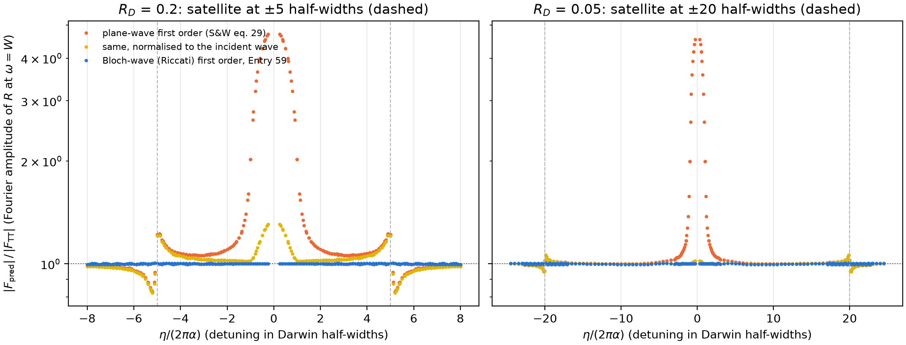
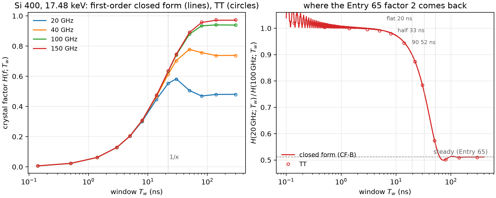
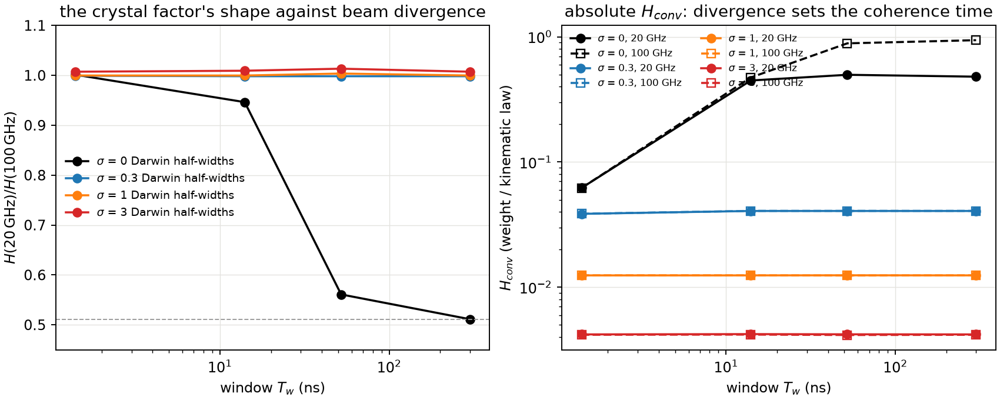
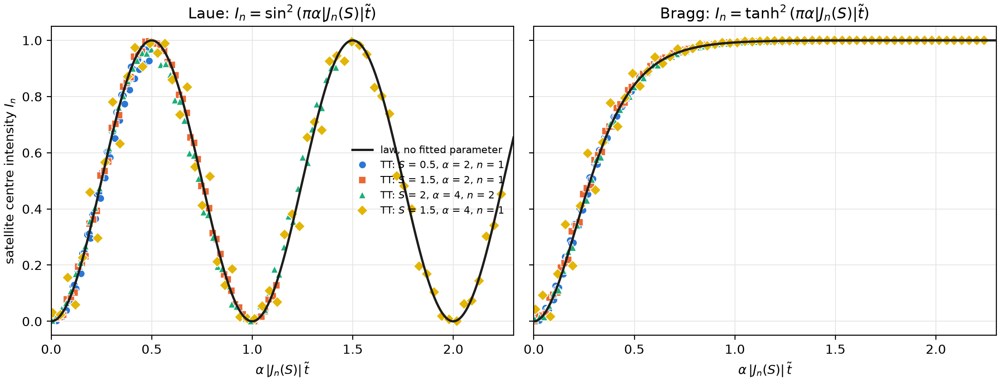
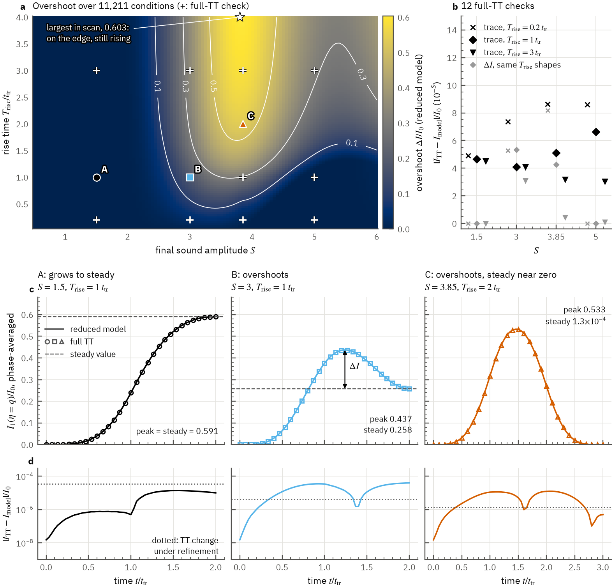

# What a time-resolved Bragg reflection measures of an acoustic strain field: a windowed crystal transfer function, its beam condition, and the dynamical formation of satellites

TraTT research report, 2026-11-16. Code: TraTT 0.1.0 (`src/tratt`, [pyproject.toml](../pyproject.toml)). Record: [lab notebook](../notes/lab_notebook.md) Entries 0-92; every number below names its entry, and where a saved result file exists, the file (`explore/nb/*.json`). Nothing was rerun for this report. All results are calculations; no experiment has been compared.

Labels used where it matters: **[fact]** is read from a result file, a notebook entry or a paper; **[inference]** is a judgement drawn from those.

## Abstract

A GHz or picosecond acoustic strain wave in a perfect crystal adds satellites to an X-ray Bragg reflection, and time-resolved measurements read phonon spectra from the time dependence of the reflectivity. We asked what the time-Fourier weight of that reflectivity measures. We solved the two-beam Takagi–Taupin (TT) equations for a strain field entering a crystal, linearised them around the static Bloch wave, and tested every closed form against full TT, with a pass/fail rule fixed before each computational run from Entry 68 on (three constants tables excepted, §2.6). To first order in the strain, the Fourier weight at the phonon frequency is the strain spectrum times the kinematic factor |R<sub>0</sub>|/ω times a crystal transfer function H(f; T<sub>w</sub>) that depends on the measurement window T<sub>w</sub>, the absorption and the anomalous absorption, with nothing fitted. For a 0.9-cycle packet in Si 400 (8 and 17.48 keV, x ≳ 27) the closed form agrees with full TT to 0.30 % at every window from 0.14 to 300 ns (0.8 % for 10- and 100-cycle packets, the second-order residual). In a model crystal (g = 0.12; packets also at g = 0.024) it also holds inside the Darwin width: for a single mode it agrees with TT to 0.5 %, where the plane-wave first-order form of Sondhauss and Wark is off by a factor 3-8. In the saved TT runs H is flat in f for short windows and approaches its steady value within the envelope e<sup>−κT<sub>w</sub></sup>, so the settling is set by absorption; the extinction phase sets only a ripple and where H stops being flat. For Si 400 at 17.48 keV the ratio H(20 GHz)/H(100 GHz) departs from 1 by 10 % at 19.6 ns and is within 10 % of its steady 0.51 from 52.2 ns. The main limit is the beam. H is a single-ray property: it is observable only with a beam whose spread in detuning σ<sub>η</sub> is below the ringing width κ + π/x, which at Si 400 (x ≳ 27) is about 0.03-0.4 µrad of angle, or 2-4 meV where the optics let bandwidth enter the detuning. In the picosecond band (x ≳ 10, σ<sub>η</sub> ≫ κ + π/x) a broader beam measures the kinematic law times a flat factor κ√(π/2)/σ<sub>η</sub>; the beam-averaged closed form agrees with the full-TT beam average to 0.02 %. At larger strain the satellite forms dynamically with extinction length Λ<sub>P</sub>/|J<sub>n</sub>(S)|. Novelty was checked against eight papers. One relevant paper, Wark and He (1994), could not be read beyond its abstract, and no novelty is claimed over it.

## 1 Background and question

### 1.1 Terms

- **Dynamical diffraction.** In a thick perfect crystal the forward beam D<sub>0</sub> and the diffracted beam D<sub>h</sub> exchange amplitude with depth. The Takagi–Taupin equations describe this exchange for a crystal whose lattice is locally displaced. For a lossless Laue slab at the Bragg condition the diffracted intensity is sin²(πL/Λ<sub>P</sub>), which defines the Pendellösung period Λ<sub>P</sub>. In Bragg geometry the reflectivity is close to 1 within the *Darwin width* and falls off outside it.
- **Extinction length.** In the Bragg sections the length unit is Λ = λ sin θ<sub>B</sub>/|χ<sub>rh</sub>| (Entry 65). A phonon of frequency f is written x = f/f<sub>D</sub> with f<sub>D</sub> = v<sub>L</sub>/Λ, which equals its detuning from the Bragg peak in Darwin half-widths. Absorption is g = κ/2πα = χ<sub>i0</sub>/|χ<sub>rh</sub>|, also in Darwin half-widths.
- **Acoustic satellites.** A displacement u = u<sub>0</sub> sin(Kz − Ωt) modulates the phase of the X-ray coupling by φ = h·u. Its Bessel expansion places satellite n at detuning β = nK with weight J<sub>n</sub>(S), where S = h·u<sub>0</sub>.
- **The estimator.** A time-resolved measurement records the reflectivity R(t) at a fixed detuning η. The oscillating part of R(t) beats the static reflection against the phonon-scattered wave (a heterodyne). Its Fourier component at the phonon frequency ω = |η| is the *Fourier weight* W(ω). Picosecond-ultrasonics analyses such as Chalise et al. [10] read phonon spectra from such weights.

### 1.2 Question

Three questions:

1. What is W(ω) in terms of the strain spectrum? In particular, is there a crystal factor to divide out, and does it hold inside the Darwin width?
2. How does that factor depend on the measurement window and on the beam actually used?
3. When the strain is not small, what replaces the linear picture?

Question 3 is also the starting question of this repository: how a satellite builds up while a GHz wave is still entering the crystal (the transient-formation study). The transfer function H (questions 1-2) is the main claim of this report. Formation, drive memory and the filled-crystal limits are reported in §3.6-3.7 as supporting results.

## 2 Model and method

### 2.1 Equations

Depth and time are written ζ = z/L and t̃ = t/t<sub>tr</sub>, with t<sub>tr</sub> = L/v<sub>s</sub>. The other dimensionless quantities are α = L/Λ<sub>P</sub>, η = βL, q = KL = 2πL/Λ<sub>ac</sub> and R = Λ<sub>ac</sub>/Λ<sub>P</sub>. Propagation is assumed nondispersive (Ω = Kv<sub>s</sub>), so the drive is

$$\varphi(\zeta;\tilde t)=S\,A(\tilde t-\zeta)\,\sin(q\zeta-q\tilde t),\qquad A(s<0)=0 .$$

Depth therefore samples the retarded history of the drive envelope A. The equations are those of [equations](equations.md) and [DESIGN.md](../DESIGN.md).

**Laue** (both beams go forward, output at the back face):

$$\frac{dD_0}{d\zeta}=i\pi\alpha e^{i\varphi}D_h,\qquad \frac{dD_h}{d\zeta}=i\pi\alpha e^{-i\varphi}D_0+i\eta D_h,\qquad D_0(0)=1,\ D_h(0)=0,\qquad I=|D_h(1)|^2 .$$

**Bragg** (reflected wave leaves through the entrance face), in the ratio r = D<sub>h</sub>/D<sub>0</sub>:

$$\frac{dr}{d\zeta}=-i\pi\alpha e^{-i\varphi}-i\eta r-i\pi\alpha e^{i\varphi}r^2,\qquad r(1)=0,\qquad I=|r(0)|^2 .$$

Normal absorption enters as η → η + iκ. Anomalous absorption χ<sub>ih</sub> enters through a complex coupling (`solve_bragg(kappa_h=)`, Entry 77). The semi-infinite crystal of the transfer-function work is integrated in retarded time s = t − ζ (Entries 66, 75). Integration is fixed-step RK4. Each run carries a step and phase convergence check.

### 2.2 Independent-satellite law

For resolved satellites under a step onset, satellite n behaves as an unstrained slab of the filled thickness with coupling α<sub>n</sub> = α|J<sub>n</sub>(S)| (Entries 1, 9):

$$I_n(\tilde t)\simeq \sin^2(\pi\alpha_n\tilde t)\ \text{(Laue)},\qquad \tanh^2(\pi\alpha_n\tilde t)\ \text{(Bragg)},\qquad \tau_n=\frac{\Lambda_P}{v_s|J_n(S)|}.$$

τ<sub>n</sub> is the characteristic time of satellite n (Entry 89). For a gradual envelope the coupling is the retarded Bessel integral Θ<sub>n</sub>(t̃) = ∫<sub>0</sub><sup>1</sup> J<sub>n</sub>[S A(t̃ − ζ)] dζ, with I<sub>n</sub> ≃ sin²(παΘ<sub>n</sub>) in Laue (Entries 28, 30).

### 2.3 First-order response and the windowed transfer function

Linearise the Bragg Riccati equation around the static root R<sub>0</sub> of the semi-infinite crystal. With c = iπα and η<sub>c</sub> = η + iκ, R<sub>0</sub> satisfies cR<sub>0</sub>² + iη<sub>c</sub>R<sub>0</sub> + c = 0 (Entry 59). For a strain packet of shape g(s) entering at t = 0, the reflection perturbation is (Entry 75, retarded time):

$$\delta(t)=-ic(1-R_0^2)\,S\int_0^t e^{\lambda_B (t-s)}g(s)\,ds,\qquad \lambda_B=i(\eta+i\kappa)+2cR_0 .$$

The notebook writes λ<sub>B</sub> as Λ; it is renamed here to avoid a clash with the extinction length. Integrating by parts over the window [0, T<sub>w</sub>] gives the closed form called CF-B:

$$F_T(W)=\int_0^{T_w}\delta\,e^{iWt}dt=\frac{ic(1-R_0^2)S\,\big[G_T(W)-e^{(\lambda_B+iW)T_w}L_T(\lambda_B)\big]}{\lambda_B+iW},$$

$$G_T(W)=\int_0^{T_w}g\,e^{iWs}ds,\qquad L_T(\lambda_B)=\int_0^{T_w}g\,e^{-\lambda_B s}ds,\qquad \tilde I(\eta)=R_0^*F_T(\eta)+R_0\,F_T(-\eta)^* .$$

Ĩ(η) is the Fourier component, at ω = |η|, of |R|² − |R<sub>0</sub>|². The crystal factor H is Ĩ divided by the kinematic law |G<sub>T</sub>(η)| |R<sub>0</sub>| παS/κ (Entry 59; Entries 75 and 78 work per extinction length, α = 1, and write πS/κ). Three limits:

- **Kinematic tail** [fact, Entry 59 §1]. |R<sub>0</sub>| ≈ πα/η, so W ∝ |ε̂|/ω² for a strain spectrum ε̂. The Fourier weight is the strain spectrum times |R<sub>0</sub>|/ω, not the strain spectrum itself.
- **Infinite window** (Entries 59, 65, 71). H<sub>∞</sub> = κ/|κ − 2cR<sub>0</sub>|, with |2cR<sub>0</sub>| ≈ π/x per Λ in the tail.
- **Packet-free short form** (CF-A, Entry 75). CF-B with L<sub>T</sub> = G(−η) and G<sub>T</sub> = G, which assumes a packet short against the window and against 1/|λ<sub>B</sub> − iη|: every kernel 1/(λ<sub>B</sub> − isW) of the cos-mode form becomes [1 − e<sup>(λ<sub>B</sub> − isW)T</sup>]/(λ<sub>B</sub> − isW). Its resonant term alone is Entry 71's hand estimate, H(f; T<sub>w</sub>) ≈ H<sub>∞</sub>(f)·|1 − e<sup>−(κ+iπ/x)T<sub>w</sub></sup>|, with T<sub>w</sub> in units of Λ/v<sub>L</sub>. CF-A was tested and rejected as a 1 % closed form for T<sub>w</sub> ≲ 100 packet lengths (§3.2).

For a single mode the first-order amplitude of the satellite is ν = |cS(1 − R<sub>0</sub>²)/(2(λ<sub>B</sub> − iW))| (Entry 65). For a packet, Entry 68 defines ν = max<sub>t</sub> |R<sub>lin</sub>(t) − r<sub>0</sub>| from a linear run scaled by S. ν sets the size of the second-order error.

### 2.4 Beam average

A beam with a spread of detunings p(δ) (angle and bandwidth combined into one Gaussian width σ<sub>η</sub>) gives the coherent sum W<sub>conv</sub>(ω) = |Σ<sub>k</sub> p<sub>k</sub> Ĩ(η + δ<sub>k</sub>; ω, T<sub>w</sub>)|. Each ray is a full TT run. The rays' intensities add, so their oscillating parts add as phasors (Entry 82). The same sum is taken over CF-B for the closed-form prediction.

### 2.5 Parameters

Si 400, symmetric Bragg, σ polarisation, X0h constants (Entry 20), v<sub>L</sub> = 8433 m/s [fact: Λ, f<sub>D</sub> and g from Entry 65; the widths from Entry 83 and `explore/nb/e82_divergence.json` "scale"]:

| E (keV) | Λ (µm) | f<sub>D</sub> (GHz) | g = χ<sub>i0</sub>/\|χ<sub>rh</sub>\| | Darwin half-width | ringing half-width κ (angle / energy) |
|---|---|---|---|---|---|
| 8 | 11.33 | 0.744 | 0.0458 | 8.33 µrad / 96 meV | 0.38 µrad / 4.4 meV |
| 17.48 | 11.54 | 0.730 | 0.0100 | 3.18 µrad / 206 meV | 0.032 µrad / 2.1 meV |

The packet is the one from Entry 66: g(s) = e<sup>−s/τ</sup> sin(q<sub>0</sub>s) with f<sub>0</sub> = 87 GHz and 0.9 cycles (τ = 10 ps). Packets of 10 and 100 cycles (τ = 115 ps and 1.15 ns) test the scope of the result. The peak strain is 10⁻⁵ or 10⁻⁶, which is linear. Satellite frequencies are 20-150 GHz, and the 13 windows run from 0.14 to 300 ns (Entry 75).

### 2.6 Protocol

From Entry 68 on, every computational entry states a pass/fail rule before its run, except Entries 73, 80 and 85, which compute constants tables with nothing pre-registered. A rule that fails is reported as failed. A threshold found after a run is labelled post hoc. The notebook keeps negative and withdrawn results. Before Entry 68 most entries state a hypothesis before the setup, without a numeric threshold; Entries 59, 64 and 65 state neither a hypothesis nor a rule.

## 3 Results

### 3.1 The first-order closed form holds inside the Darwin width

Test case: α = 8 and κ = 6 (g = 0.12), with packet spectra centred at 20, 5 and 2 Darwin half-widths (R<sub>D</sub> = 0.05, 0.2 and 0.5, the Darwin half-width over the packet frequency). The Fourier weight is taken exactly at ω = |η| [fact, Entry 59]:

| R<sub>D</sub> | W<sub>TT</sub>/W<sub>pred</sub> where W > 2 % of max | kinematic law off by up to |
|---|---|---|
| 0.05, S = 0.02 | median 0.985, range 0.971-1.010 | 0.84 |
| 0.2 | median 1.021, range 0.969-1.048 | 45× |
| 0.5 | median 0.993, range 0.767-1.065 | 48× |

A longer window (T = 0.6 → 1.2) moves the 1.021 median to 0.999. A ±3.5 % scatter is not identified (Entry 59). At weak absorption (g = 0.024) the median is 0.993 (`e59_weak.json`).

**Against the plane-wave first order** [fact, Entry 64, `explore/nb/e64_sw.json`]. A single mode fills the crystal (α = 8, κ = 6, S = 0.02). The table gives |F<sub>pred</sub>|/|F<sub>TT</sub>| at the satellite:

| mode frequency (Darwin half-widths) | Sondhauss–Wark eq. 28-29, literal | incident-normalised | Bloch-wave (Riccati) |
|---|---|---|---|
| 20 | 1.022 | 1.021 | 1.005 |
| 5 | 1.220 | 1.207 | 1.003 |
| 2 | 1.687 | 1.567 | 1.001 |
| 1 | 3.014 | 1.673 | 1.000 |
| 0.5 | 8.450 | 12.96 | 1.000 |

With the Bloch wave (1, R<sub>0</sub>)e<sup>cR<sub>0</sub>ζ</sup> in place of constant amplitudes, the two-field first-order solution equals the Riccati form to 6×10⁻¹⁶. The only modelling difference is therefore the constant-amplitude ansatz, which ignores extinction with depth (Entry 64).



*Figure 1. First-order Fourier amplitude at the mode frequency divided by full TT, against detuning in Darwin half-widths (α = 8, κ = 6, S = 0.02). Left: mode at 5 half-widths; right: 20 half-widths. Points with |F<sub>TT</sub>| above 2 % of its maximum. Data `explore/nb/e64_sw.json`; script `explore/nb/paper_figs.py fig2`.*

**Real crystal** [fact, Entry 65, `e65_si400.json`]. For a steady single mode in Si 400 the crystal factor is:

| f (GHz) | 5 | 10 | 20 | 40 | 60 | 100 | 170 |
|---|---|---|---|---|---|---|---|
| H, 8 keV | 0.52 | 0.77 | 0.93 | 0.98 | 0.99 | 1.00 | 1.00 |
| H, 17.48 keV | 0.135 | 0.26 | 0.48 | 0.74 | 0.85 | 0.94 | 0.98 |

H(20 GHz)/H(100 GHz) = 0.51 at 17.48 keV and 0.93 at 8 keV. In the linear regime (S = 0.002, 48 steps per cycle) converged TT differs from the closed form by 0.2 % at x = 30 and 1.3 % at x = 100 at 17.48 keV, and by 0.1 % and 0.5 % at 8 keV (Entry 65 §3 table; the entry's verdict rounds this to ≤ 0.5 %; no log of the S = 0.002 run was saved, and `e65_conv.log` holds the S = 0.02 run). At S = 0.02 the difference grows as ν² (4.4 % at x = 30, 25 % at x = 100, 17.48 keV): the satellite stops being linear. The `tt` run in `e65_si400.log` used 24 steps per cycle, is not converged at x ≥ 30, and is not used.

### 3.2 The crystal factor needs a long window

The steady H applies only to long windows. Entry 71 tested the step from a steady single mode to a 140 ps measurement under a rule fixed before the run. Result: the steady value does not apply to such a measurement [fact, `explore/nb/e71_window_H.json`]:

| f (GHz) | 20 | 40 | 87 | 150 |
|---|---|---|---|---|
| steady H/H(100), 17.48 keV | 0.511 | 0.786 | 0.982 | 1.034 |
| 140 ps window | 1.015 | 1.039 | 0.957 | 1.039 |
| 1.4 ns | 0.999 | 1.000 | 0.996 | 1.006 |
| 14 ns | 0.944 | 0.986 | 0.998 | 1.004 |

The windowed closed form CF-B (§2.3) was then tested against full TT. The rule allowed a worst deviation of 1 % over all frequencies and windows [fact, Entry 75, `explore/nb/e75_window_cf.json` "worst"]:

| packet | CF-A (packet-free) | CF-B (packet kept) |
|---|---|---|
| 0.9 cycles, both energies | 8.3 % (0.14 ns, 87 GHz): **rejected** | 0.30 % |
| 10 cycles | 41 % | 0.78 % (0.08 % at S/1000, post-hoc run) |
| 100 cycles | 49 % | 0.80 % (0.21 % at S/1000, post-hoc run) |

The residual of CF-B shrinks with the strain (post-hoc run at S/1000), so it is the second-order term of TT. CF-A holds only for T<sub>w</sub> ≳ 100τ. A post-hoc check identifies the cause: CF-A drops the packet's group delay and takes the phase of the −η image term from a cos mode (Entry 75 §3).

The design numbers for Si 400 at 17.48 keV, with the 20 GHz / 100 GHz ratio taken from CF-B and confirmed by TT [fact, `e75_window_cf.json` "bounds"]:

| boundary | target ratio | T<sub>w</sub> | CF-B | TT |
|---|---|---|---|---|
| T<sub>flat</sub> (10 % below flat) | 0.900 | 19.6 ns | 0.899 | 0.897 |
| T<sub>half</sub> (halfway to steady) | 0.756 | 32.8 ns | 0.754 | 0.752 |
| T<sub>90</sub> (within 10 % of steady) | 0.560 | 52.2 ns | 0.560 | 0.558 |

The crystal factor is flat to 1 % up to 5 ns. It is not monotonic in T<sub>w</sub>: at 20 GHz it reaches 0.58 at 30 ns and 0.47 at 80 ns before settling at 0.48. This is the |1 − e<sup>−(κ+iπ/x)T</sup>| ripple, with period 2xΛ/v<sub>L</sub>, and TT reproduces it. At 8 keV (1/κ = 4.67 ns) H is steady from 30 ns on (Entry 75 §4).



*Figure 2. Si 400, 17.48 keV, 0.9-cycle packet. Left: crystal factor H(f; T<sub>w</sub>) at 20, 40, 100 and 150 GHz, CF-B (lines) and full TT (circles). Right: H(20 GHz)/H(100 GHz) with T<sub>flat</sub>, T<sub>half</sub> and T<sub>90</sub>; dashed, the steady value 0.511. Below 0.5 ns the ±3 % oscillation is the −η image term of a truncated real signal; it is part of CF-B. Data `explore/nb/e75_window_cf.json`; `explore/nb/e75_window_cf.py run posthoc fig`.*

**The window law** [fact for the comparison, Entry 92, `explore/nb/e92_window_law.log`; inference for the general form]. In the Entry 75 TT data, H(f; T<sub>w</sub>)/H(f; 300 ns) follows the resonant-term form |1 − e<sup>−(κ+iπ/x)T<sub>w</sub></sup>| of §2.3 to 0.22 % at 17.48 keV and 0.11 % at 8 keV for T<sub>w</sub> ≥ 5 ns, and its distance from the steady value stays inside the envelope e<sup>−κT<sub>w</sub></sup> (to 0.002). The approach to the steady value is therefore set by absorption alone. The extinction phase π/x sets the ripple period 2xΛ/v<sub>L</sub> and, through |κ + iπ/x|, the window below which H is flat in f. For Si 400 at 17.48 keV, H is flat while T<sub>w</sub> ≪ 1/|κ + iπ/x| = 10.5-21.1 ns (20-150 GHz). The settling constant is 1/κ = 21.8 ns, about 185 µm of acoustic travel; this is a time scale, not a sufficient window. H is within 10 % of its steady value at every tested frequency once T<sub>w</sub> ≥ ln 10/κ = 50 ns (10.7 ns at 8 keV). At 150 GHz, where x/π = 89 ns, H(80 ns) is already 0.984 of the steady value. A picosecond packet followed over a delay scan of ≥ 52 ns (T<sub>90</sub>) satisfies the 20 GHz / 100 GHz design numbers above. The notebook first stated this law as "the strain must travel ≥ max(1/κ, x/π) Λ" (Entries 71, 75, 90); Entry 92 corrects it.

### 3.3 Main limit: the crystal factor is a single-ray property

Each ray at detuning η + δ rings at its own frequency with damping κ. The weight at the nominal frequency therefore collects only the rays within a complex Lorentzian of half-width κ, centred at the extinction shift π/x (Entry 82, stated before the run). Rule: full TT beam average against CF-B convolved over the same beam, 1 % at any (f, σ, T<sub>w</sub>). Si 400, 17.48 keV, S/1000 [fact, `explore/nb/e82_divergence.json`]:

| σ (Darwin half-widths) | H<sub>conv</sub> | H(20)/H(100) over 1.4-300 ns | TT/closed form |
|---|---|---|---|
| 0 | 0.062 / 0.448 / 0.497 / 0.480 at 20 GHz for 1.4 / 14 / 52 / 300 ns | 1.001 → 0.511 | 0.9998-1.0001 |
| 0.3 | 0.0386-0.0406, all f equal to 0.3 % | 0.998-0.999 | 0.9998-1.0001 |
| 1 | 0.0124, all f, all T<sub>w</sub> | 1.000-1.004 | 0.9998-1.0001 |
| 3 | 0.0042, all f, all T<sub>w</sub> | 1.007-1.013 | 0.9998-1.0001 |

- **Closed form retained.** The worst deviation is 0.021 % (file: "worst" 2.07×10⁻⁴). The beam average of CF-B is the closed form with divergence; no extra term is needed. Halving the δ grid changes W<sub>conv</sub> by 6×10⁻⁷ relative.
- **Flat factor.** For σ ≥ 0.3 Darwin half-widths, H<sub>conv</sub> is flat in f at every window. Its value is κ√(π/2)/σ<sub>η</sub>: expected 0.0418 / 0.0125 / 0.0042, found 0.0407 / 0.0124 / 0.0042 (3 % low at σ = 0.3, where σ<sub>η</sub> is only 14× the Lorentzian half-width).
- **No window law.** The ringing of different rays dephases after 1/σ<sub>η</sub> (0.7 ns at σ = 0.3). The effective window is min(T<sub>w</sub>, 1/σ<sub>η</sub>, 1/κ). T<sub>flat</sub> and T<sub>90</sub> exist only for σ ≲ 0.01-0.05 Darwin half-widths.



*Figure 3. Si 400, 17.48 keV. Left: H<sub>conv</sub>(20 GHz)/H<sub>conv</sub>(100 GHz) against window for Gaussian spreads σ = 0, 0.3, 1 and 3 Darwin half-widths; only the single ray (σ = 0) shows the window law. Right: absolute H<sub>conv</sub> at 20 and 100 GHz; for σ > 0 it is flat in f and in T<sub>w</sub> at κ√(π/2)/σ<sub>η</sub>. Data `explore/nb/e82_divergence.json`; `explore/nb/e82_divergence.py run fig`.*

**The condition, stated plainly** [fact for the numbers, inference for the reading]. The steady H, the window law and design numbers of §3.2, and the χ<sub>ih</sub> effects of §3.4 are observable only with an incident beam whose spread in detuning is below the ringing width κ + π/x. The requirement is on σ<sub>η</sub>, the spread in detuning. At Si 400 (x ≳ 27) the ringing width corresponds to **about 0.03 µrad (17.48 keV) to 0.4 µrad (8 keV) of angle, or 2-4 meV of bandwidth where the bandwidth enters the detuning**. An angle-resolving detector of that resolution removes only the angular part. Ordinary beams are 100-1000× broader (Entry 82). That estimate adds angle and bandwidth in quadrature; Entry 83 (addendum c) corrects it: after a crystal monochromator the two are correlated, a non-dispersive arrangement cancels the bandwidth in η, and σ<sub>η</sub> must be computed from the actual optics. The requirement on σ<sub>η</sub> itself stands; a separate bandwidth requirement does not. In the picosecond band (x ≳ 10, σ<sub>η</sub> ≫ κ + π/x), a beam that fails it measures the kinematic law, "divide by |R<sub>0</sub>|/ω", times a flat factor, with no frequency-dependent crystal correction.

**At GHz-train frequencies** [fact, Entry 83, `e83_lowx.json`]. At x = 1-10 the 5 % tolerance on σ<sub>η</sub>, given as its angle or bandwidth equivalent, at 8 keV is 0.63 µrad / 7 meV (x = 1) to 0.26 µrad / 2.9 meV (x = 10). At 17.48 keV it is ≤ 0.14 µrad / 9 meV. At x ≲ 2 the beam average first *raises* the factor (up to 2.0× at 17.48 keV) before suppressing it, because the single-ray resonance sits at π/x from the nominal detuning. The flat law of the previous paragraph therefore holds for x ≳ 10, not for a GHz train.

### 3.4 Crystal parameters of H: anomalous absorption, asymmetric geometry, polarisation

- **χ<sub>ih</sub> is a second parameter** [fact, Entry 77, `e77_chi_ih.json`]. With χ<sub>ih</sub>/χ<sub>i0</sub> = 0.93 (X0h), H changes by 0.9 % (steady), 1.0 % (14 ns) and 1.4 % (52 ns) over 20-150 GHz at 17.48 keV, and by 2.8-3.2 % at 8 keV (up to 4.5 % at 5-10 GHz), with opposite signs on the two sides of the Bragg peak. The pre-registered 1 % rule fired, by the 52 ns window; at the steady limit and at 14 ns it would have passed by 0.02-0.09 %. The extended closed form agrees with TT to 0.3 %.
- **±η side asymmetry** [fact, Entry 78, `e78_side_asymmetry.json`, pre-registered]. With χ<sub>ih</sub>, the two detunings of one phonon frequency have different H. A = H(−η)/H(+η) − 1 is up to 1.9 % at 17.48 keV (300 ns window), up to 2.8 % at 52 ns, and 6.2 % at 8 keV and 20 GHz. Full TT agrees with the closed form to 0.06 %. Two different packets give the same ratio to 0.1 %, so the strain spectrum cancels. The ratio reads χ<sub>ih</sub>/χ<sub>i0</sub> with sensitivity 0.02-0.07 per unit. It is not observed. Being odd in δ, it averages to zero over a symmetric beam, so it needs the single-ray condition of §3.3.
- **Asymmetric Bragg** [fact, Entry 81, `e81_asym_map.json`]. The asymmetric case is an exact rescaling of the symmetric solver (machine precision). H keeps its form with g → g(√b + 1/√b)/2, b = γ<sub>0</sub>/|γ<sub>h</sub>|, and lengths in Λ<sub>asym</sub>. T<sub>90</sub> shortens from 52 to 33 ns at b = 4.
- **Polarisation and Debye–Waller** [fact, Entry 88, `e88_polarisation_dw.json`]. π polarisation is the σ form with α → Cα and κ fixed. An unpolarised beam is a two-term sum, which agrees with TT to 0.02 %. Its effect is within 0.3 % of σ at Si 400 / 8 keV (C² = 0.12) but 2-32 % at Si 440 / 17.48 keV, where the polarisation state must be known. Static Debye–Waller is already inside the X0h constants.

### 3.5 Where first order stops

- **Linearity bound** [fact, Entry 68, `e68_nu_collapse.json`]. Over 24 series (Bragg, x ∈ {2, 5}, g ∈ {0.01, 0.046, 0.12}, packets of 1-30 cycles, ν as Entry 68 defines it, §2.3) the weight at the spectral peak, K = (W(S)/S)/(W(S<sub>lin</sub>)/S<sub>lin</sub>), satisfies 1 − K ≤ 1.8ν² for ν ≤ 0.3. So ν ≲ 0.1 keeps the weight linear to 2 % on this domain. This is a sufficient condition on the scanned domain, not a law.
- **The single-criterion hypothesis is falsified** [fact, Entry 68]. Pre-registered rule: at equal ν, 1 − K must not spread by more than ×2 across packet length, absorption and satellite position. Found: ×14 at ν = 0.1 and ×10 at ν = 0.3. ν alone does not join the linear and dynamical regimes; Entry 68 tested this one definition (and a two-term fit) and no other candidate number.
- **Two nonlinearities** [fact, Entry 65, `e65_packet.json`]. At the spectral peak the weight saturates by about ν². In the wings the second harmonic grows with S itself (J<sub>2</sub>(S); 2.6× its linear value at S = 0.7). This is kinematic and known in kind.

### 3.6 Beyond first order: the satellite forms dynamically

When ν is not small the satellite is a dynamical reflection with its own extinction length Λ<sub>P</sub>/|J<sub>n</sub>(S)| (§2.2).

**Formation order follows |J<sub>n</sub>(S)|** [fact, Entry 1; no result file exists for this table, compared against the notebook only]. Times are in t<sub>tr</sub>:

| S | α | n | J<sub>n</sub>(S) | full TT first maximum | law |
|---:|---:|---:|---:|---:|---:|
| 1 | 2 | 1 | 0.440 | 0.570 | 0.568 |
| 3 | 2 | 2 | 0.486 | 0.500 | 0.514 |
| 3 | 2 | 1 | 0.339 | 0.750 | 0.737 |
| 3 | 2 | 3 | 0.309 | 0.825 | 0.809 |

The largest centre-intensity discrepancy among the tabulated cases is 0.079 (S = 0.5, α = 2), which Entry 1 links to the static rocking-curve tail. Over 30 random conditions the worst absolute centre error is 0.031 for R ≤ 0.05, 0.075 for 0.05 < R ≤ 0.10, and 0.112 for 0.10 < R ≤ 0.20 [fact, Entry 19]. These are sampled errors, not bounds.



*Figure 4. Centre intensity of satellite n behind a step front against α|J<sub>n</sub>(S)|t/t<sub>tr</sub>, four (S, α, n) cases, Laue (left) and Bragg (right); full TT (markers) and sin², tanh² (lines), no fitted parameter. Data `explore/nb/poster_f1_points.npz`; `explore/nb/paper_figs.py fig4b`.*

**The formation law has its own beam condition** [fact, Entry 84, `e84_satellite_divergence.json`]. Eight cases were averaged in full TT over Gaussian beams. Both criteria (first-maximum time within 1 %, height within 5 %) hold for σ<sub>η</sub> ≲ 0.3 w<sub>n</sub> in all four Bragg cases, where w<sub>n</sub> = 2πα|J<sub>n</sub>| is the satellite's own rocking width. In Laue the largest passing σ<sub>η</sub> is 0.3, 0.1, < 0.1 and < 0.1 w<sub>n</sub> in the four cases: two pass at no scanned width (one of them partly through a period-metric artefact). In angle that is ≲ 0.13 µrad in Laue at Si 440 / 17.48 keV (< 0.06 µrad for (S, α, n) = (2, 4, 2)), and 0.13-0.3 µrad (Si 440 / 17.48 keV) or 0.6-1.4 µrad (Si 400 / 8 keV) for the Bragg cases. At σ<sub>η</sub> = w<sub>n</sub> the first maximum loses 13-21 % (Bragg) and 25-40 % (Laue).

**The integrated population as the beam-tolerant observable** [fact, Entries 86, 87]. Entry 86 failed under its own rule (its amplitude metric compared differently normalised means). In Entry 87, with corrected metrics fixed in advance, the main criterion, 3w<sub>n</sub>, failed in 3 of 5 runs. The pre-registered fallback scan of 3, 5 and 10w<sub>n</sub> gives 5w<sub>n</sub> for all step runs (2-5 µrad at Si 440 / 17.48 keV) and 10w<sub>n</sub> for the ramp (10 µrad); Entry 87 classes this "confirmed, with a condition". The law of that observable is the TT channel integral itself (tabulated), not sin², and the condition rests on five runs.

### 3.7 Drive memory, overshoot and the filled-crystal limit

These are supporting results of the formation study.

- **Memory** [fact, Entry 30]. Under a triangular drive (S<sub>max</sub> = 3, Laue, α = 0.5), the n = 1 centre intensity at the same instantaneous amplitude A = 0.3 is 0.010 on the rising path and 0.494 on the falling path. The difference reflects different retarded depth profiles, not material hysteresis.
- **Overshoot map** [fact, Entry 67, `explore/nb/e67_overshoot.json`]. The scan covers 11,211 (S, T<sub>rise</sub>) conditions of a linear ramp (Laue, α = 0.5, α<sub>ac</sub> = 40, n = 1) under the Θ<sub>1</sub> law. The largest excess over the steady value is 0.603 at S = 3.8. It lies on the T<sub>rise</sub> = 4t<sub>tr</sub> edge of the scan, so the maximum over T<sub>rise</sub> is outside the scan. Full TT at twelve conditions and three traced cases agrees to 8.65×10⁻⁵, with an excess error of 8.18×10⁻⁵. Map refinement changes the excess by at most 4.49×10⁻⁶. These checks are selected points, not a global bound.



*Figure 5. First satellite, Laue, α = 0.5, R = 0.0125, linear turn-on. (a) Overshoot ΔI over 101 × 111 (T<sub>rise</sub>, S) conditions from Θ<sub>1</sub>; crosses mark the twelve full-TT checks. (b) Their largest deviations. (c) Cases A-C, model and full TT. (d) Model error along the traces. Full caption in the [README](../README.md#results). Data `explore/nb/e67_overshoot.npz`, `.json`; `explore/make_overshoot_figure.py`.*

- **Filled-crystal limit** [fact, Entries 42, 54]. An independent Floquet solver agrees with full TT to 1.6×10⁻⁶-1.3×10⁻⁵ at five (α, α<sub>ac</sub>, S) points. The median steady-population error of independent satellites reaches 5 % at R = 0.34-0.57, depending on S.

### 3.8 Negative, falsified and withdrawn results

| claim | outcome | by |
|---|---|---|
| ν alone joins the linear and dynamical regimes | falsified (×10-14 spread at fixed ν) | Entry 68 |
| the steady H explains the low-frequency deficit of a 140 ps packet measurement (Chalise et al.) | withdrawn: H is flat to 4 % for that window; only a second-order factor K = 0.65-0.88 applies | Entry 71 (withdraws Entry 65 §2, Entry 66 §3) |
| packet-free closed form CF-A in T<sub>w</sub> | rejected below ~100τ (8.3 %) | Entry 75 |
| the window law: the strain must travel ≥ max(1/κ, x/π) Λ | corrected: the settling is set by 1/κ alone; x/π sets the ripple and the flat regime (§3.2) | Entry 92 (corrects Entries 71, 75, 90) |
| formation-law beam tolerance in Laue, 0.1-0.3 µrad at Si 440 / 17.48 keV | corrected: ≲ 0.13 µrad, < 0.06 µrad for (2, 4, 2); 0.13-0.3 µrad is the Bragg range | Entry 92 (corrects the Entry 84 verdict) |
| the crystal moves the Fisher-information maximum away from the signal maximum (ps packet, one angle) | negative: the amplitude maxima coincide (3 GHz apart, under the 8.7 GHz threshold) and the crystal moves nothing; the frequency grid was cut at 30 GHz as a labelled post-hoc change | Entry 70 |
| integrated-population beam threshold at 3w<sub>n</sub> | failed in 3 of 5 runs (fallback 5w<sub>n</sub> / 10w<sub>n</sub>, §3.6) | Entry 87 |
| acoustic phase walls are a new mechanism | withdrawn: the 1968 stacking-fault formula reproduces n = 1, 2 within 1-3 %; n = 3 differs (up to 15 % against ≤ 1.3 %), unexplained | Entry 56 |
| a shear-wave second-harmonic column in the realisability table | withdrawn (shear symmetry) | Entry 80 |
| chirps, walls and a 250-case search find a new effect | negative: nothing qualitatively new | Entry 41 |

## 4 Discussion

### 4.1 What the result says

[inference] The Fourier weight of a time-resolved Bragg reflectivity is not the strain spectrum. It is the strain spectrum times the static reflection amplitude over ω (a kinematic heterodyne factor), times a crystal factor H. The crystal factor has a clear physical origin. The perturbation launched by the strain rings at the detuning; it decays over the absorption depth, and its phase turns over the extinction depth. A window or a beam that cuts this ringing short removes H. Hence the two conditions: a window long enough for the ringing to settle, which takes a few absorption times 1/κ (the extinction phase adds a ripple but does not set the settling, Entry 92), and a beam narrower than the ringing linewidth κ + π/x. The second condition is the stronger. For an ordinary beam it removes H altogether. The practical message for picosecond ultrasonics is the simpler one: divide by |R<sub>0</sub>|/ω, and expect no frequency-dependent crystal correction. The full H(f; T<sub>w</sub>) is an inelastic-scattering-grade measurement (meV, sub-µrad). No proposed or existing experiment is shown here to meet that condition.

### 4.2 Prior work

Eight papers were read in full or as an accepted manuscript. The per-paper record, with page and equation numbers, is in Entries 64, 90 and 91.

- **Known, cited and not claimed** [fact]. The first-order linearisation of TT for a phonon is in Sondhauss and Wark 2003 (eq. 25-31), and Sheppard et al. 2005 use it again. The asymmetric-geometry factor g(√b + 1/√b)/2 is Wark and Lee 1999 eq. 11. Polarisation C appears in Sondhauss and Wark eq. 26, 29 and in Wark and Lee eq. 13. The parameter k = ψ″<sub>H</sub>/ψ′<sub>H</sub> (χ<sub>ih</sub>) is Wark and Lee eq. 12. Reading phonon frequencies from time Fourier transforms of diffraction data is in Reis et al. 2001 (p. 3073) and Trigo et al. 2013 (Fig. 3-4). That the Darwin width and extinction bound which phonons appear as sidebands is stated qualitatively by Reis et al. (p. 3072-3073) and Shayduk et al. 2013 (eq. 12).
- **Precursors in kind** [fact for the text, inference for the comparison]:
  - Wark and Lee 1999 (p. 700-702): with a perturbation front moving in, the reflectivity time scale is set by the front crossing an absorption depth. This is the settling scale of the window law, for a different perturbation and an integrated reflectivity. After the correction of Entry 92 the settling scale is known in kind; the closed form in T<sub>w</sub>, its flat regime and its ripple are not in Wark and Lee.
  - Reis et al. 2001 (p. 3073): "dephasing (due to a small momentum spread of the x-rays)" limits the detection of oscillations to about 10 GHz. This is the physical idea of the beam condition in one clause, with no formula or threshold.
  - Sondhauss and Wark 2003 (p. 12) and Sheppard et al. 2005 (p. 184): their plane-wave first order fails within about one rocking-curve width. §3.1 gives its size in our variables.
- **Not found in the eight papers** [inference, limited to them]:
  - the Bloch-wave first-order H valid inside the Darwin width;
  - its closed form in the window length, with the flat regime and the ripple (the settling scale is the precursor above);
  - the quantitative beam condition and the flat factor κ√(π/2)/σ<sub>η</sub>;
  - the effect of χ<sub>ih</sub> on H and the ±η asymmetry;
  - the ν bound as a quantified bound on the weight. It is partly known: Sondhauss and Wark (p. 12) give a rule of thumb, satellite ≤ 10 % of the main peak, and Sheppard et al. (Fig. 4) show intensity ∝ amplitude² up to 1 Å.

  Chukhovskii and Förster 1995 and Wark and Lee 1999 contain no first-order strain form. udkm1Dsim (Schick et al. 2014) computes the full dynamical response numerically with a transfer matrix per atomic plane, at every detuning. It would give H for one case by brute force, but it has no closed form and no Fourier estimator. A one-case cross-check against it is the cheapest answer to the objection that the TT solver itself is wrong; it was not run.
- **Not read** [fact]. Wark and He, Laser Part. Beams 12, 507 (1994): the abstract only; the article is paywalled and no open copy was found. Per its abstract it treats the temporal response of crystals to short X-ray pulses in the dynamical and kinematic regimes. **No novelty is claimed over it.** Also not read: the Methods and Supplementary Information of Trigo et al. 2013 (Entry 91); Entin (1977, 1979) and Iolin and Entin (1983) on the X-ray–acoustic overlap regime (Entry 51); Authier and Simon part II for the q-wall (Entry 56); Bucksbaum and Merlin (1999) and Grigoriev et al. (2006) (`notes/paper_draft.md` §6).

### 4.3 Formation law

[inference] The formation law (§3.6) extends known results: temporal Pendellösung for n = 0 (DeCamp et al. 2001) and the static extinction length of acoustically modulated crystals (Polikarpov and Skadorov 1987, 1988). The extension is to every order behind a travelling front, in both geometries, with no fit. As a centre observable it needs its own narrow beam (σ<sub>η</sub> ≲ 0.3w<sub>n</sub> in Bragg, narrower in Laue). The beam-tolerant form, the integrated Laue population, holds from 5w<sub>n</sub> in the four step runs and needs 10w<sub>n</sub> for the ramp, but its formation curve is a TT table rather than a closed law, and the Bragg population is not clean even at 10w<sub>n</sub> (Entries 86, 87). A bulk GHz shear-wave experiment of the needed amplitude does not yet exist. The transducer peak power it needs (6-100 W/cm² at 1-2 GHz for S = 1-2, up to 900 W/cm² at S = 6) is unverified (Entries 73, 80).

## 5 Limitations

- **Model.** The model is two-beam, plane-wave and quasi-static: an X-ray crossing takes 0.99 ps against a 500 ps acoustic period in the least favourable proposed case (Entry 62). The crystal is centrosymmetric. Strain enters only as the phase h·u, with no elasto-optic change of χ<sub>h</sub> and no dynamic Debye–Waller factor. Lateral acoustic uniformity is assumed. The bulk wave is nondispersive and enters from the surface at t = 0.
- **Geometry and absorption.** Bragg: symmetric, or asymmetric by rescaling, with normal and anomalous absorption. Laue: symmetric and lossless only.
- **First order.** The closed form is first order in S (ν ≪ 0.1). The ±η ratio was verified at peak strain 10⁻⁶. Inside the Darwin width the |R<sub>0</sub>| asymmetry (up to 10 %) must be carried in the ±η ratio; all phonon-band numbers are at x ≥ 27.
- **Crystal thickness.** Windows longer than 14 ns put the front 0.1-2.5 mm deep, so the crystal must be that thick.
- **Beam.** All single-ray results hold only for a beam spread below κ + π/x. The beam was modelled as one Gaussian in detuning, with angle and bandwidth combined. Correlated angle–energy distributions after real crystal optics were not modelled.
- **Coverage.** The parameter scans are finite: Si 400 and Si 440, two energies, one packet family plus two lengths, x ∈ {2, 5} for the linearity bound. Agreement at the tested points is not a uniform error bound. Entry 1's formation table has no saved result file. A ±3.5 % scatter in Entry 59 is unexplained.
- **Comparison with measurement.** Chalise et al. did not publish their energy, window and normalisation in the needed form. The comparison with their spectrum is "same sign, same order", not a reconstruction. No measured satellite formation, uncertainty or detection limit exists.
- **Prior art.** Wark and He 1994 unread (§4.2).

## 6 Conclusion

To first order in the strain, the time-Fourier weight of a time-resolved Bragg reflectivity is the strain spectrum times |R<sub>0</sub>|/ω times a closed-form crystal factor H(f; T<sub>w</sub>). For a 0.9-cycle packet in Si 400 it agrees with full TT to 0.30 % at every window from 0.14 to 300 ns, and in a model crystal it holds inside the Darwin width. In the saved TT runs it approaches its steady value within e<sup>−κT<sub>w</sub></sup>, with a ripple from the extinction phase (Si 400, 17.48 keV: T<sub>flat</sub> 19.6 ns, T<sub>90</sub> 52.2 ns); that the settling is set by absorption alone in general is an inference from the closed form. It needs a beam whose spread in detuning is within the ringing linewidth: at Si 400 (x ≳ 27) about 0.03-0.4 µrad of angle, or 2-4 meV where bandwidth enters the detuning. With an ordinary beam in the picosecond band the factor is flat, κ√(π/2)/σ<sub>η</sub>, and the kinematic estimator is correct as it stands; at GHz-train frequencies the beam-averaged factor depends on x and σ together. This narrow-beam condition is the main limit on the claim's experimental relevance. Against the eight papers read, the closed form in the window length and the quantitative beam condition were not found; the settling scale of the window, the absorption depth, is known in kind (Wark and Lee 1999). The linearisation, the geometry and polarisation factors, χ<sub>ih</sub> as a parameter, and Fourier-transform phonon spectroscopy are prior art. Wark and He 1994 remains unread. When the strain is not small, the satellite forms dynamically with extinction length Λ<sub>P</sub>/|J<sub>n</sub>(S)|. That law also holds only for a beam narrower than the satellite's own rocking width.

## 7 How to reproduce

Setup: `uv sync --extra dev`, then `uv run pytest -q` for the solver tests (analytic limits, Floquet cross-check, formation law). Every command below runs from the repository root and prints its numbers. Most write a `.json` next to the script in `explore/nb/` (the saved `.log` files are captured console output) and, with `fig`, a figure in `figures/paper/` (Entries 59 and 65 write to `figures/`). `e65_si400.py` writes its JSON only with `tt`, the unconverged check that §3.1 does not use; the converged check is `e65_conv.py`. `e65_packet.py` writes `e65_packet.json` to the current directory, so it runs from `explore/nb`. Times are from the notebook entries.

```
uv run python explore/nb/e59_transfer.py fig weak                # closed form vs TT, Entry 59
uv run python explore/nb/e64_sw_compare.py                       # plane-wave vs Bloch-wave first order (9 s), Entry 64
uv run python explore/nb/e65_si400.py                            # H for Si 400 at 8 and 17.48 keV, Entry 65
E65_S=0.002 E65_PER=48 uv run python explore/nb/e65_conv.py 0.01 30 100   # converged TT check, Entry 65 (bash syntax)
(cd explore/nb && uv run python e65_packet.py)                   # few-cycle packet: saturation and harmonics, Entry 65
uv run python explore/nb/e68_nu_collapse.py run stats fit2 fig   # linearity bound, falsification (28 s), Entry 68
uv run python explore/nb/e71_window_H.py                         # window test (11 s), Entry 71
uv run python explore/nb/e75_window_cf.py run posthoc fig        # H(f; T_w) vs TT and the boundaries (110 s), Entry 75
uv run python explore/nb/e77_chi_ih.py run ttp ttm conv60 fig    # anomalous absorption (170 s), Entry 77
uv run python explore/nb/e78_side_asymmetry.py run fig           # ±η asymmetry, Entry 78
uv run python explore/nb/e81_asym_map.py run                     # asymmetric Bragg rescaling, Entry 81
uv run python explore/nb/e82_divergence.py run fig               # beam average of H (13 s), Entry 82
uv run python explore/nb/e83_lowx.py run fig                     # beam condition at x = 1-10, Entry 83
uv run python explore/nb/e84_satellite_divergence.py run fig     # beam condition for the formation law, Entry 84
uv run python explore/nb/e88_polarisation_dw.py                  # polarisation and Debye-Waller, Entry 88
uv run python explore/nb/e92_window_law.py                       # window law against the saved Entry 75 TT data, Entry 92
uv run python explore/nb/paper_figs.py fig2                      # Figure 1
uv run python explore/nb/paper_figs.py fig4b                     # Figure 4
uv run --group figures python explore/make_overshoot_figure.py   # Figure 5, from the saved Entry 67 data
```

The script for every other entry, with its arguments, is in [lineage](lineage.md#2-scripts-and-notebook-entries). The claim table with each claim's status is in [`notes/paper_draft.md`](../notes/paper_draft.md) §4. The scores of the candidate papers are in [`notes/paper_candidates.md`](../notes/paper_candidates.md).

## References

Prior art read in full unless marked otherwise; the reading record is in Entries 64, 90 and 91.

1. P. Sondhauss and J. S. Wark, Acta Cryst. A 59, 7-13 (2003). doi:10.1107/S010876730201704X.
2. F. N. Chukhovskii and E. Förster, Acta Cryst. A 51, 668-672 (1995).
3. J. S. Wark and R. W. Lee, J. Appl. Cryst. 32, 692-703 (1999).
4. J. M. H. Sheppard, P. Sondhauss, R. Merlin, P. Bucksbaum, R. W. Lee and J. S. Wark, Solid State Commun. 136, 181-185 (2005).
5. D. A. Reis et al., "Probing impulsive strain propagation with x-ray pulses", Phys. Rev. Lett. 86, 3072-3075 (2001).
6. M. Trigo et al., "Fourier-transform inelastic X-ray scattering from time- and momentum-dependent phonon–phonon correlations", Nat. Phys. 9, 790-794 (2013). Accepted manuscript read; Methods and Supplementary Information not read.
7. D. Schick et al., "udkm1Dsim – A simulation toolkit for 1D ultrafast dynamics in condensed matter", Comput. Phys. Commun. 185, 651-660 (2014).
8. A. Shayduk et al., "Direct time domain sampling of sub-THz coherent acoustic phonon spectra in SrTiO3 using ultrafast X-ray diffraction", Phys. Rev. B 87, 184301 (2013). arXiv:1303.5643.
9. J. S. Wark and H. He, "Subpicosecond X-ray diffraction", Laser Part. Beams 12, 507-513 (1994). **Abstract only.**
10. Chalise et al., arXiv:2603.28071 (2026). The spectral-weight measurement discussed in Entries 57, 66 and 71.
11. P. H. Bucksbaum and R. Merlin, Solid State Commun. (1999), "phonon Bragg switch". Not read; bibliographic details not checked.
12. M. F. DeCamp et al., "Coherent control of pulsed X-ray beams", Nature 413, 825 (2001). As recorded in the notebook; not re-read for this report.
13. I. V. Polikarpov and V. V. Skadorov, Phys. Status Solidi B 143, 11 (1987); 149, 435 (1988). As recorded in the notebook.
14. A. Authier and D. Simon, Acta Cryst. A 24, 517-526 (1968). Part I read (Entry 56); part II not read.
